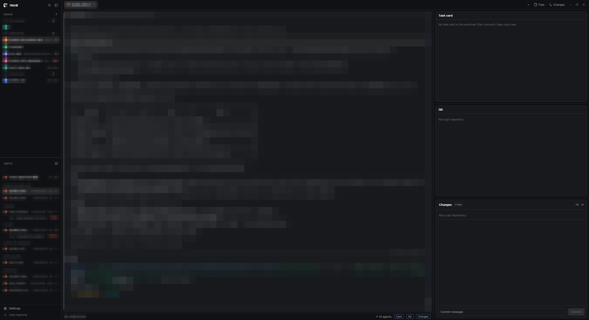

# Herdr + taskdesk

A layout for working with coding agents: Spaces and Agents on the left, your tab in the middle, and a
right-hand column with the Task card, the Git graph and Changes. A statusline under the tab toggles
those panels. This file is the recipe an agent follows to add it.

## What you see

- **Sidebar**, 268px: the brand bar, **Spaces** (`spaces`), **Agents** (`lite-agents`, the agents list
  with each agent's task-card `Next` line) and the footer (`workspace-chrome`).
- **Work column**: the tab bar (`tabs`), then a row with the shown tab as cards (a `pane` header on every
  pane), Herdr's hidden Files/Changes panel, and the **right column** (360px, 240 to 700px when dragged):
  - **Task card** (`lite-card`): the card of the focused terminal's folder, with Lint and Handover buttons.
  - **Git** (`lite-git`): the Git graph. Click a commit to show its files in Changes.
  - **Changes** (`lite-changes`): a folder tree of the uncommitted files, or of the selected commit. **Pop out**
    opens the diff in a window (`lite-diff`) that follows the file you click.
- **Statusline** (`lite-status`) under the tab: machine, branch, ahead/behind, changed files, agent count,
  and Card / Git / Changes buttons that show or hide each right-hand panel.

## How it behaves

- Every panel follows the **live** folder of the focused terminal, including terminals on other machines.
- Hiding the last right-hand panel hides the column too; showing any of them brings it back.
- Without the `task-card` skill on a machine, the Task card panel is empty and its Lint / Handover buttons
  do not show. Everything else works. Do not install the skill for the person.
- The diff window cannot be dragged to resize; its `-` / `+` buttons step through four sizes.

## Add it

1. Get this repository into an empty folder of your own (`git clone`, or download the zip). Work from that copy.
2. Herdr's home is `~/.config/herdr-app` (`HERDR_APP_HOME` picks another). Check it for the names
   `lite-agents`, `lite-card`, `lite-changes`, `lite-diff`, `lite-git`, `lite-status` under `mods/` and
   `taskdesk` under `layouts/`. If any exists, it is the person's: stop and ask whether to rename ours
   (and the matching `mod` names in the layout) instead of overwriting.
3. Copy the six folders of `mods/` into `<home>/mods/` and `layouts/taskdesk.json` into `<home>/layouts/`.
4. Run `herdr-app check <home>/mods/<name>` for each of the six mods. Fix what it reports before going on.
5. `herdr-app do layout.switch --name taskdesk` (or `ctrl-shift-l`). Herdr hot reloads; nothing to restart.

## Built from

- `layouts/taskdesk.json`: the window. It starts from the Shepherdr layout's left-hand skeleton and adds the
  right column and the statusline.
- `mods/lite-agents` and `mods/lite-changes`: clones of Herdr's shipped `agents` and `changes` (0.1.13).
- `mods/lite-card`, `mods/lite-git`, `mods/lite-diff`, `mods/lite-status`: new.
- Shipped mods it uses: `workspace-chrome`, `spaces`, `tabs`, `pane`, `files`, `changes`.
- Its look is Herdr's: no theme or fonts of its own, so the person's settings decide it.

## Watch out

- `lite-card` and `lite-agents` each have a `card.js`; the two files are identical and must stay so.
- The mods talk through Herdr `shared` keys `lite.commit` and `lite.diff.view`. Keep the six together.
- `lite-card` runs `~/.claude/skills/task-card/lint.py` (when present) and, on Handover, types
  `/task-card handover` into the focused agent if it is idle. `lite-git`, `lite-changes` and `lite-diff` run
  read-only `git` commands in the terminal's folder. Nothing reaches the network.
- Cloned mods and layouts are never updated: a later Herdr may change `agents`, `changes` or `main`.
  Rebuild from this recipe on a new version rather than keeping an old clone.
- Do not edit the person's other layouts, `keys.json` or `settings.json`.

## Done when

- `herdr-app check` passes for all six mods and `herdr-app status` shows no errors; there is no
  `layouts/taskdesk.error`.
- The right column shows Task card, Git and Changes, and the statusline buttons hide and show them.
- Selecting a commit in Git lists its files in Changes; selecting the latest commit (HEAD) shows the uncommitted files again.
- `ctrl-shift-l` cycles back to the person's own layout.
